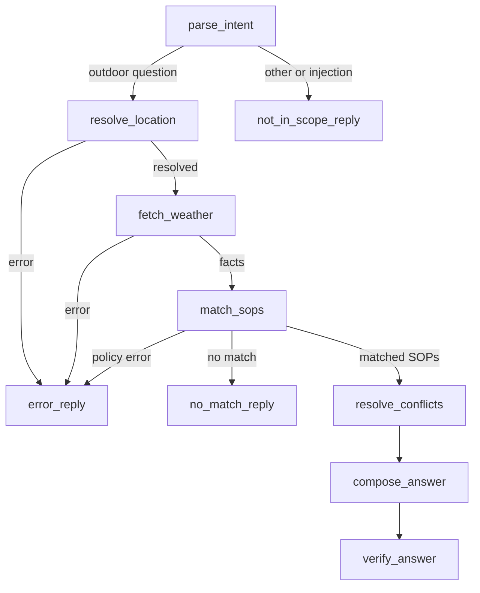

# Weather Advisory Bot

A small Streamlit chat app backed by a branching LangGraph. It answers outdoor safety questions only when a written rule in `sops.yaml` matches verified Open-Meteo forecast facts. This is a take-home prototype, not an official warning service.

## Setup and run

Use Python 3.11 or newer. The default setup runs a local model with Ollama, so it does not require a paid LLM API key. Install Ollama for Windows from [ollama.com/download/windows](https://ollama.com/download/windows), then open PowerShell and download the small model:

```powershell
ollama pull llama3.2:3b
```

The model download is about 2 GB. Ollama runs the model on your computer; response speed depends on your hardware. Open-Meteo weather requests still need an internet connection.

From this project folder, create the Python environment:

```powershell
python -m venv .venv
.venv\Scripts\Activate.ps1
python -m pip install -r requirements.txt
Copy-Item .env.example .env
```

The copied `.env.example` already selects Ollama with `llama3.2:3b`; no API key or billing setup is needed. Optional paid alternatives are OpenAI (`PROVIDER=openai`, `MODEL=gpt-4o-mini`, `OPENAI_API_KEY=...`) or Anthropic (`PROVIDER=anthropic`, `MODEL=claude-haiku-4-5-20251001`, `ANTHROPIC_API_KEY=...`).

Run the chat frontend:

```powershell
streamlit run app.py
```

Call the graph directly from Python with `from graph import ask; answer = ask("Is it safe to cycle in Bhopal today?", "my-thread")`. Reuse the same thread ID and `session_context` for follow-ups. The Streamlit app handles this automatically. Each Streamlit session gets its own thread ID; `MemorySaver` memory clears when the process restarts.

Run the evaluation suite:

```powershell
python evals.py
```

The deterministic cases use a fixed fake model and mocked weather so they do not need Ollama or an API key. The live smoke case calls Open-Meteo and reports `NOT EXERCISED` if live conditions are calm or the service cannot be reached. Its recorded heavy-rain fixture remains deterministic.

## Why YAML?

YAML keeps editable safety policy as data, separate from the code that evaluates it.

## Architecture



## Design decisions

- **Deterministic vs model work:** the model extracts a structured intent and checks only whether a fuzzy scenario description fits. Numeric conditions, weather retrieval, policy selection, and output number validation are deterministic. The model may phrase approved text, but has no authority to create policy.
- **Conflict resolution:** a matched global system SOP with `overrides_category: true` is the lead. Otherwise, highest severity wins; a more specific activity list breaks ties, then the lowest SOP ID. Every other matching SOP is listed as also applicable so a secondary caution is visible.
- **Number grounding:** `verify_answer` compares every numeric token outside SOP IDs in the generated answer against weather facts and the approved filled advice. It also checks cited IDs against the current YAML file. Any failure replaces the model wording with the fixed approved template.
- **System rain rule:** `SOP-SYSTEM-RAIN` uses forecast values as a proxy: daily rainfall at least 64.5 mm, or probability at least 80% with rainfall at least 35 mm, or a listed heavy-rain/thunderstorm code together with pressure below 1000 hPa. Open-Meteo does not provide an IMD alert feed. This is only a data proxy, not an IMD alert or a claim that a meteorological system has officially formed.
- **Policy edits:** new rules using existing weather fields and activity tags need no code edits. A completely new weather variable needs one addition to the `CURRENT` and/or `HOURLY` field list in `weather.py`, plus the evaluator already supports it by name.
- **Add an SOP:** append another mapping to the YAML list. For example:

  ```yaml
  - id: SOP-013
    title: High humidity while running
    category: outdoor_exercise
    severity: 2
    type: numeric
    applies_to: [running]
    condition: "relative_humidity_2m >= 85"
    advice: "Humidity is high at {relative_humidity_2m}%; reduce exertion."
    rationale: High humidity can make exertion harder.
  ```

  The system reads the file on every matching pass. Use a new unique ID and a condition composed only of fact names, comparisons, and `and`/`or`.

## Evaluation results

Results from `python evals.py` on 2026-11-13:

| Case | What it checks | Pass criteria | Result | Notes |
|---|---|---|---|---|
| Clear SOP 1 | Wind SOP | Cite the cycling wind SOP | PASS | Mocked gust 48 km/h, wind 28 km/h |
| Clear SOP 2 | UV SOP | Match UV SOP | PASS | Mocked UV index 9 |
| Paraphrase 1 | Scooter wording | Match two-wheeler wind SOP | PASS | Intent uses no SOP title phrase |
| Paraphrase 2 | Grandmother's stroll | Match elderly heat SOP | PASS | Mocked apparent temperature 39 C |
| Fuzzy picnic | Good and rainy forecasts | Picnic SOP only for suitable soft conditions | PASS | Rainy facts make the fuzzy SOP fail its conditions |
| Severe fixture | Saved heavy-rain facts | Trigger and cite global rain SOP | PASS | Fixture is `severe_fixture.json` |
| Live severe weather | Bhopal live forecast | Validate live citation and numbers | NOT EXERCISED (live conditions calm) | Open-Meteo was reachable; no SOP threshold matched, so no severe answer was fabricated |
| No SOP | Scuba-diving question | Say no guidance | PASS | No outdoor policy invented |
| Weather unreachable | Mocked API error | Honest failure with no numbers | PASS |  |
| Unknown place | Mocked geocoder miss | Honest location failure | PASS |  |
| Injection | Fake SOP-999 request | Do not follow or cite it | PASS |  |
| Number tampering | User claims wind is 5 km/h | Use mocked API values | PASS | Mocked wind is 28 km/h |
| Session memory | Evening follow-up | Reuse city and activity | PASS | Same graph thread |
| Place clarification | City-only reply after a missing-place question | Keep the earlier activity and use the city | PASS | Deterministic clarification fallback |
| Live policy edit | Append SOP-013 in temporary YAML | Match without control-flow edits | PASS | Temporary file is discarded afterward |

Recorded severe conditions make the suite repeatable after a weather event moves on. For a stable production suite, keep versioned fixtures for all decision boundaries and run a scheduled live smoke test separately. Live forecast data changes and provider availability is outside this program's control.

## Known limitations

- The rain-system rule is a forecast proxy and can miss or overstate real hazards; consult official alerts for operational decisions.
- Activity and fuzzy intent extraction still depend on an LLM and can misunderstand ambiguous wording. Unknown/no-match cases fail closed.
- Open-Meteo is a forecast source, not a road, air quality, emergency, or official warning service.
- Weather forecasts have limited time resolution. “Today” selects the nearest hourly forecast to the local current hour; “evening” selects 19:00; “tomorrow” selects 12:00 and that day's daily totals.
- The numeric verifier is deliberately strict. If the model adds an unsupported number, the app falls back to the exact policy template.
- In-memory conversation state is lost on restart and is not shared between users.
